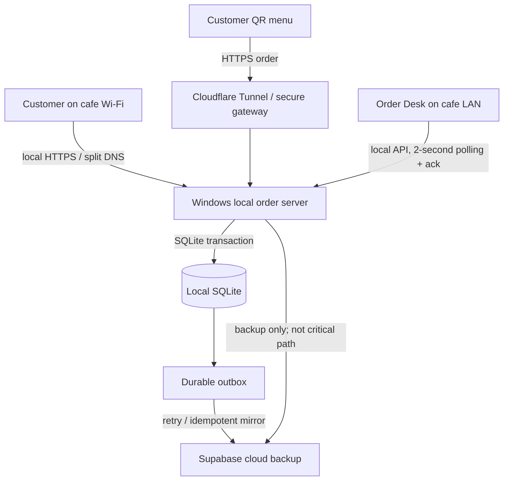

# TCC Local Order Server (parallel prototype)

Status: **development only**. This folder is isolated from the live Supabase order path. Do not deploy or switch production traffic until the acceptance tests and owner approval are complete.

## Verified current system (2026-11-26)

- Production site: https://tcc-restaurant-website.pages.dev/
- Production branch: `main`; current development branch for this work: `feature/local-order-server`.
- Supabase project: `pcxsdypqlavtulidpydn`, region Mumbai (`ap-south-1`), Edge Function `tcc-orders`.
- Customer checkout in `script.js` POSTs `action=create-order` to the Supabase function.
- The frontend uses a UUID idempotency key stored in sessionStorage for the pending cart signature. The server checks the key and the database has a unique idempotency index.
- The current function validates a dedicated table QR for dine-in orders, normalizes the 10-digit phone, and stores order/items/totals in `public.tcc_orders`.
- `orders-dashboard.js` loads `action=orders`, polls `new-order-notifications` every 8 seconds, and polls `orders-updates` approximately every 30 seconds. Staff status changes are sent to the same Edge Function.
- The Order Desk login uses the Edge Function's `login` action; current repository source derives the password hash with PBKDF2-SHA256 (310,000 iterations), stores only hashed session tokens, and uses a 12-hour session with `x-tcc-admin-session`. The Edge Function uses the Supabase service-role key server-side.
- The function source also exposes `update-status`, `edit-order`, `archive-order`, `restore-order`, `delete-order`, `archived-orders`, customer/order lookup, menu availability, table QR management, and assistance history/attendance actions. Preserve these staff workflows during later adapter work.
- Public table requests use `create-table-assistance`; `request_type` is `staff` or `bill`. A pending request is deduplicated by table and request type.
- Current related data includes `tcc_orders`, `tcc_table_qr_tokens`, `tcc_table_assistance_requests`, `tcc_admin_sessions`, and supporting menu/settings/audit tables.
- The repository handoff mentions Edge Function v20 active as of 15 Nov, but live function/database state has not been independently queried in this implementation session. Verify before any migration.
- Recent main commit (26 Nov) fixes the order list query to use existing database columns; preserve this correction.

## Architecture decision

Use Node.js LTS + Express + `better-sqlite3` (single local Windows PC). SQLite is the simplest fit for one host: no separate DB service, atomic transactions, WAL, durable storage and easy backup. Do not self-host Supabase or add PostgreSQL unless measured needs require it.

### Data flow

**Important network limitation:** remote customers require working cafe internet and a live PC/tunnel. When cafe internet is down, local Wi-Fi devices can still reach the server; mobile-data customers cannot reach the cafe PC. The customer must see a clear failure, never a false success.

Preferred public route: Cloudflare Tunnel to the PC, no router port-forwarding. For LAN traffic, investigate router split-horizon DNS for the same HTTPS hostname to the PC's private address, using a browser-trusted certificate. If the router cannot do this reliably, LAN devices may use the tunnel while internet is available; direct LAN/offline access requires a valid local HTTPS hostname/certificate and compatible browser permissions. Never use insecure mixed-content HTTP from the HTTPS website.

The current website is on a `pages.dev` hostname; a stable custom order hostname requires a domain/zone managed in Cloudflare (for example, `orders.<TCC-domain>`). The repo does not establish that TCC already has a custom domain, so domain setup is a prerequisite to a stable public tunnel hostname. A temporary Cloudflare Tunnel hostname is suitable only for development. A browser-trusted certificate is needed for split-DNS direct LAN HTTPS; a Cloudflare Origin CA certificate alone is not browser-trusted. The server supports HTTPS when `HTTPS_KEY_PATH` and `HTTPS_CERT_PATH` are configured. A sample tunnel config is in `cloudflared/config.yml.example`.

## Delivery semantics

- Local order write + idempotency record + outbox event are committed in one SQLite transaction.
- Return success only after commit, with `order_id`, `order_number`, `received_at`, and `delivery_state=received`.
- The Desk fetches pending events and explicitly acknowledges after rendering. Until ack, the server returns the event again (at-least-once); Desk deduplicates by stable `order_id`.
- `delivered_to_desk` means the authenticated Desk acknowledged the order, not merely that a network request was sent.
- Cloud sync is independent and retryable; it cannot block local order acceptance.
- Cloud sync uses the same idempotency key and immutable local ID mapping. Retries must upsert by unique key and never create a second order.
- If the local server/database is unavailable, customer submission fails visibly. Do not fall back to a second writer (Supabase) automatically unless a single-writer/fencing protocol is proven; two independent writers can create split-brain and duplicates.

## Local data model

- `orders`: stable UUID, production-compatible `TCC-YYYYMMDD-TABLE-###` reference (or `TAKEAWAY`), unique idempotency key, full order JSON, customer phone, status, timestamps, Desk acknowledgement and cloud sync state.
- `order_sequences`: atomic per-date/per-table order reference counters seeded from both local history and today's cloud order references during QR/settings refresh. This reduces collisions when the local writer is activated; pilot must still use a single active order writer.
- `order_events`: monotonically increasing sequence, event type, order/request ID, JSON payload, creation time, desk ack.
- `table_requests`: stable request ID, table, type (staff/bill), pending/attended status, created/attended timestamps, unique open request constraint.
- `qr_tokens`: SHA-256 hash only, table, active flag, last sync. Raw QR tokens are never stored.
- `menu_availability`: cached sold-out/available overrides keyed exactly like the production menu override logic, so sold-out products remain blocked during a Supabase outage.
- `outbox`: entity ID/type, operation, idempotency key, retry count, next retry, last error, sync status.
- `sync_cursor`: checkpoint for cloud reconciliation.
- `audit_log`: append-only staff action log.

## API prototype

- `GET /health` — process and database health, no secrets.
- `POST /v1/orders` — public order submission; requires idempotency UUID, cached ordering-enabled setting, and valid cached active table QR.
- `GET /v1/ordering-status` — public cached ordering status; returns disabled until the first successful settings sync.
- `POST /v1/admin/qr-cache` — refresh QR-token cache and the cached customer-ordering pause setting.
- `GET /v1/admin/orders?limit=250` — authenticated Desk order snapshot.
- `GET /v1/admin/events?after=<seq>` — durable Desk event feed; unacknowledged events are returned again.
- `POST /v1/admin/events/:seq/ack` — Desk acknowledges an event after rendering.
- `PATCH /v1/admin/orders/:id` — authenticated production-compatible status change with item updates, audit and cloud outbox event.
- `POST /v1/table-requests` — public staff/bill request with QR.
- `GET /v1/admin/table-requests` and `PATCH /v1/admin/table-requests/:id` — Desk list/attend.
- `GET /v1/admin/events?after=<seq>` — durable events for polling recovery.

The first prototype exposes a small compatibility layer; it does not replace the current Supabase function or change frontend/Order Desk production calls. It supports continuation of recent orders only when the parent order is already present in the local database; pre-cutover cloud orders need an approved import/reconciliation path before this feature is enabled.

### Prototype runbook

From this folder on a development machine:

1. Install Node.js LTS and run `npm install`.
2. Copy `.env.example` to `.env`; generate a local staff token with `node -e \"console.log(require('crypto').randomBytes(32).toString('hex'))\"\` and keep it private.
3. Start `npm start`.
4. Start QR cache refresh in a separate terminal with `npm run sync-qr` (requires the service-role key only in the local `.env`).
5. Start cloud sync in a separate terminal with `npm run cloud-sync`; it retries pending outbox entries and does not block order intake.
6. Open `http://127.0.0.1:8787/desk/desk.html`, enter the local admin token and use the standalone test desk to verify order receipt/acknowledgement and status changes.
7. Run `npm run check` and `npm test`.

The current customer website and production `orders.html` are not yet wired to this local API. The standalone Desk is a test harness; customer frontend and existing Desk adapter integration are a later phase on this branch.

## Estimated remaining stages

- **Stage A — Local intake and persistence (prototype):** order API, SQLite schema, idempotency, durable events/outbox, standalone Desk harness, QR cache and restart tests. Initial prototype is committed; CI covers core API behavior.
- **Stage B — Compatibility adapter:** connect the customer checkout and the existing Order Desk to the local API behind a feature flag; preserve current UI and staff workflows. Estimate 1–2 focused days after API contract review.
- **Stage C — Windows/network installation:** PC service/task setup, trusted TLS, Cloudflare Tunnel, Access policy, split-DNS and firewall validation. Estimate 0.5–1.5 days depending on domain/router/certificate setup.
- **Stage D — Cloud mirror and backup validation:** verify the live schema read-only, run sync/reconciliation and backup restore tests, check status edits and table requests. Estimate 1–2 focused days.
- **Stage E — Pilot and cutover:** test busy service windows, failure injection, then a small approved pilot with rollback. Allow 2–3 operating sessions for observation.

Overall planning estimate: roughly 4–7 focused engineering days plus real cafe pilot sessions; network/domain setup or schema discrepancies can extend this. This is a planning range, not a guarantee.

## Security

- Bind the service to the cafe LAN interface; Windows Firewall allow inbound only from the private cafe subnet. Do not expose a raw port to the internet.
- Cloudflare Tunnel is outbound-only; protect staff APIs with a separate high-entropy local admin token and/or Cloudflare Access. Do not blindly enable Express `trust proxy`; validate the tunnel's forwarded client-IP behavior first, then configure a trusted proxy strategy or edge rate limit. Do not place the admin token in public frontend code.
- Public routes validate request size, phone, item count, integer quantity/currency, QR token, idempotency UUID, ordering pause and cached sold-out state. Express currently rate-limits by the connection IP it sees; behind Cloudflare Tunnel that may aggregate clients to localhost, so configure Cloudflare edge rate limits and verify client-IP behavior before public pilot.
- Current Supabase function accepts client-supplied prices. This is an existing business/security gap. Before production cutover, build a server-controlled menu/add-on price catalogue and reject mismatches; never treat the client total as authoritative.
- Store secrets in a local `.env` excluded from Git. Restrict Windows ACLs to the service account/admin. Rotate tokens if exposed.
- Do not log customer phone numbers, QR tokens, passwords, bearer tokens or full request bodies.
- Use HTTPS for all browser-to-server traffic. CORS allowlist only the TCC Pages origin(s); no wildcard in production.
- Local QR-token cache, online-ordering enabled/paused setting, and menu sold-out overrides are refreshed from Supabase when available and persist through internet outages. New orders fail closed until the ordering setting has synchronized at least once. A revoked QR may remain accepted until cache refresh; define a short TTL and emergency local revoke mechanism before launch.

## Windows PC setup (to finalize after hardware/network check)

1. Install supported Node.js LTS; verify `node -v` and `npm -v`.
2. Create a dedicated `C:\TCC\LocalOrderServer\` directory and service account.
3. Install dependencies and initialize database under `C:\ProgramData\TCC\OrderServer\` (not in repo/user Downloads).
4. Configure `.env` with port, LAN host, admin token, Supabase URL/service key (server-only), and allowed origin.
5. Install as a Windows service (recommended: WinSW or NSSM after reviewing IT policy); set automatic start and restart on failure. Alternatively Task Scheduler with boot trigger and restart-on-failure.
6. Disable sleep during cafe hours; keep display sleep enabled. Configure UPS if available.
7. Windows Firewall: allow only private subnet and required service port; no router port-forwarding.
8. Cloudflare Tunnel: create a named tunnel and route the order hostname to local HTTPS origin; use Cloudflare Access for admin endpoints.
9. Configure daily SQLite online backup, rotate logs, monitor disk space and `/health`.
10. Test restore from backup and service recovery before pilot.
11. The setup script is a starting point, not a completed PC installation. Review the scheduled-task identity, folder ACLs, TLS renewal and Windows Firewall subnet rule before registering or starting tasks. Do not run it on the cafe PC until configuration is approved.

## Test and migration gates

- Normal order: persisted, Desk fetches, Desk ack, customer receives reference.
- Concurrent repeated request with same idempotency key: exactly one order.
- Rapid distinct orders: all unique, ordered by creation/sequence.
- Desk closed/crashed after fetch but before ack: event reappears and Desk deduplicates.
- Supabase down/quota exhausted: local order accepted and visible to local Desk; outbox pending.
- Internet down: LAN order works; remote order shows failure; tunnel reconnects automatically.
- PC/server crash/restart: SQLite recovers; unacked events and outbox resume.
- Disk full/DB locked/corrupt: no success response; health alarm; recovery procedure.
- Cloud sync retries and then reconciles by idempotency key; no duplicate rows.
- QR disabled in cloud while offline: cached QR behavior and revoke window tested.
- Status transitions and table staff/bill requests remain consistent.
- Backups restore into a clean test directory and match order/event counts.
- Load test concurrent checkout and Desk polling; measure p95 persistence and notification latency.

Cutover requires an explicit owner approval, a controlled pilot, and rollback to the existing Supabase function. Keep Supabase and its function active throughout initial migration. No production deploy or live database change is authorized by this prototype.
